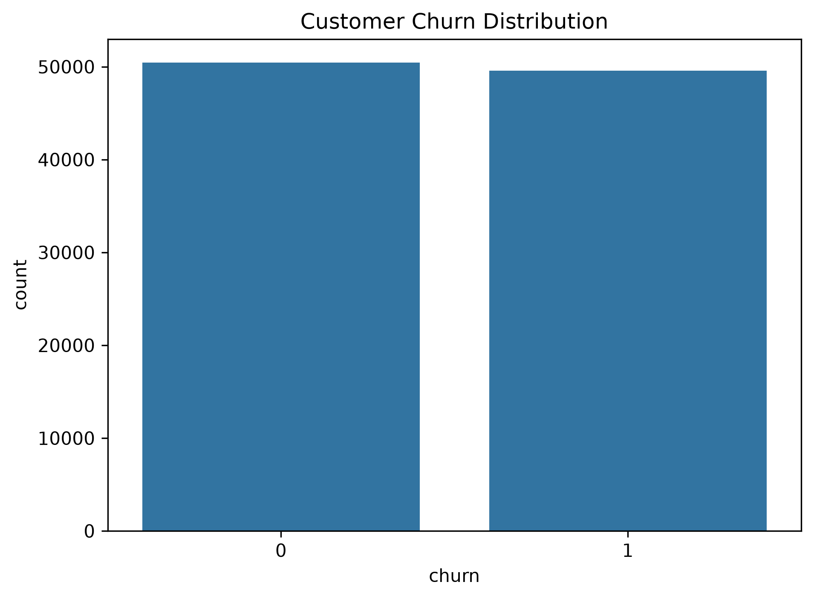
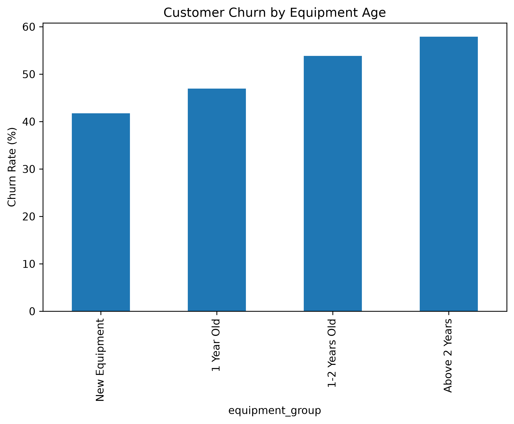
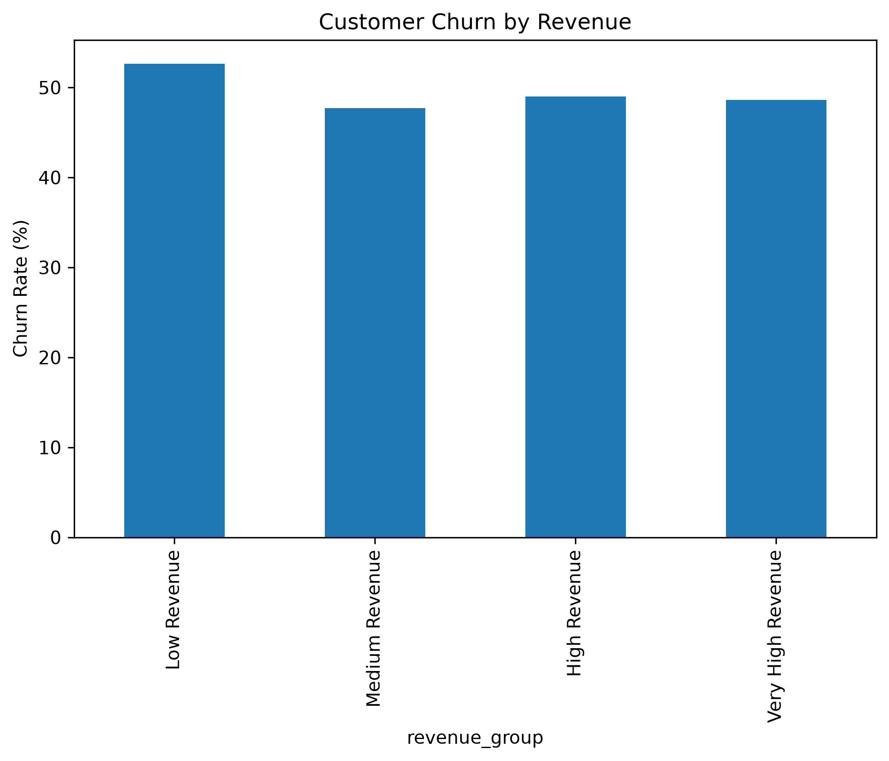
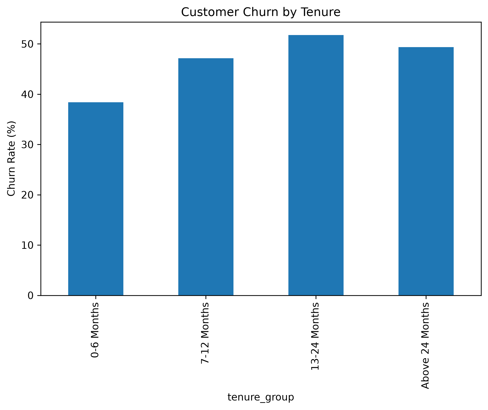
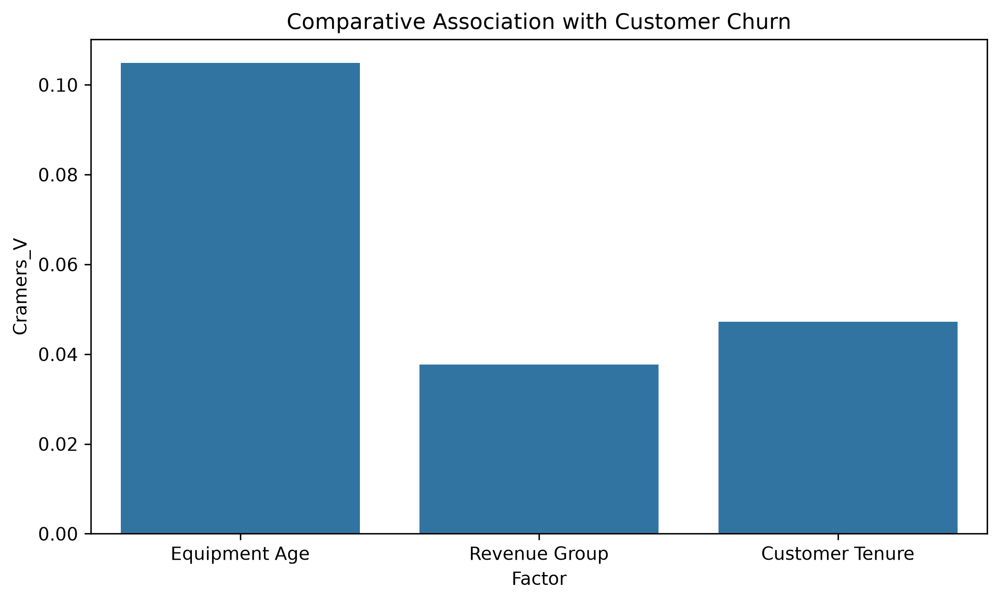

<div align="center">

# 📊 Customer Churn Analysis

### Understanding Customer Behavior Through Data Analytics and Statistical Analysis

[](https://python.org)
[](https://pandas.pydata.org/)
[](https://numpy.org/)
[](https://matplotlib.org/)
[](https://seaborn.pydata.org/)
[](https://jupyter.org/)

</div>

---


**A Data Analysis Project Using Python**

## 📑 Table of Contents

- [Project Overview](#1-project-overview)
- [Project Objectives](#2-project-objectives)
- [Dataset Description](#3-dataset-description)
- [Tools and Technologies](#4-tools-and-technologies)
- [Project Workflow](#5-project-workflow)
- [Exploratory Data Analysis](#6-exploratory-data-analysis)
- [Statistical Analysis](#7-statistical-analysis)
- [Key Findings](#8-key-findings)
- [Business Recommendations](#9-business-recommendations)
- [Project Structure](#10-project-structure)
- [Installation and Usage](#11-installation-and-usage)
- [Project Outputs](#12-project-outputs)
- [Conclusion](#13-conclusion)
- [Author](#author)

---

## 1. Project Overview

Customer churn is an important challenge for businesses, especially in the telecommunications industry. Losing existing customers can affect business revenue and long-term growth.

This project analyzes customer churn patterns using two datasets, `Client.csv` and `Record.csv`. The datasets are merged using a common customer ID to perform exploratory data analysis, data visualization, and statistical analysis.

The main goal is to identify customer groups associated with higher churn rates and provide useful business recommendations.

## 2. Project Objectives

- Analyze customer churn distribution.
- Identify missing values and understand data quality.
- Explore customer behavior and usage patterns.
- Analyze churn across equipment age, revenue, and customer tenure.
- Perform statistical tests to examine associations with churn.
- Develop data-driven business recommendations.

## 3. Dataset Description

The project uses two datasets:

| Dataset | Description |
|---|---|
| Client.csv | Customer demographic and service information |
| Record.csv | Customer usage, revenue, and churn information |

The datasets were initially inspected separately to understand their structure, dimensions, missing values, and data quality. Both datasets contained 100,000 records and were merged using `Customer_ID` as the common key. An inner join with one-to-one validation was used to ensure correct matching.

After merging, the final dataset contained **100,000 rows and 100 columns**.

**Dataset Summary:**
- Client Dataset: 100,000 records
- Record Dataset: 100,000 records
- Common Key: `Customer_ID`
- Merged Dataset: 100,000 rows and 100 columns

### 📈 Dataset at a Glance

| Metric | Value |
|---|---:|
| Total Customers | 100,000 |
| Total Features | 100 |
| Retained Customers | 50,438 |
| Churned Customers | 49,562 |
| Overall Churn Rate | 49.56% |


## 4. Tools and Technologies

- Python
- Pandas
- NumPy
- Matplotlib
- Seaborn
- SciPy
- Jupyter Notebook
- Visual Studio Code

## 5. Project Workflow
1. **Environment Setup:** Imported the required Python libraries.
2. **Data Loading:** Loaded the Client and Record datasets.
3. **Dataset Inspection:** Examined dataset dimensions, data types, missing values, duplicate records, and memory usage.
4. **Dataset Merging:** Matched both datasets using `Customer_ID` with an inner join and one-to-one validation.
5. **Data Quality Assessment:** Analyzed missing values and explored data quality.
6. **Exploratory Data Analysis:** Examined churn distribution and customer behavior.
7. **Statistical Analysis:** Applied correlation analysis and Chi-square tests.
8. **Visualization:** Created charts to identify patterns and relationships.
9. **Business Insights:** Summarized findings and developed recommendations.

## 6. Exploratory Data Analysis

The analysis includes:

- Customer churn distribution
- Missing value analysis
- Customer usage patterns
- Customer care interactions
- Customer tenure analysis
- Revenue group analysis
- Equipment age analysis
- Demographic analysis

## 7. Statistical Analysis

The following statistical techniques were applied:

- Chi-Square Test of Independence
- Cramér's V Association Strength
- Correlation Analysis

### Comparative Statistical Results

| Factor | Chi-Square | Cramér's V |
|---|---:|---:|
| Equipment Age | 1099.3107 | 0.1048 |
| Revenue Group | 141.8787 | 0.0377 |
| Customer Tenure | 223.4121 | 0.0473 |

All three factors showed statistically significant associations with customer churn (p < 0.05).

However, their association strengths were relatively weak.


## 📊 Data Visualizations

### 1. Customer Churn Distribution



### 2. Equipment Age vs Churn



### 3. Revenue Group vs Churn



### 4. Customer Tenure vs Churn



### 5. Comparative Statistical Analysis



---


## 8. Key Findings

1. **Equipment Age:** Customers using equipment older than two years have the highest churn rate (57.89%).

2. **Revenue Group:** Low-revenue customers have the highest churn rate (52.65%).

3. **Customer Tenure:** Customers with 13–24 months of tenure have the highest churn rate (51.78%).

4. **Usage Pattern:** Customers with slight usage decreases show a churn rate of 55.53%.

5. **Customer Care:** Customers with low customer-care interactions have a higher churn rate (51.23%) than those with high interactions (44.66%).

6. **Statistical Association:** Equipment Age has the strongest association with churn among the three statistically tested factors.

## 9. Business Recommendations

- **Equipment Upgrade:** Encourage customers using older equipment to upgrade their devices.
- **Affordable Packages:** Introduce suitable packages for low-revenue customers.
- **Customer Retention:** Develop targeted retention campaigns for customers with 13–24 months of tenure.
- **Customer Monitoring:** Regularly monitor customer usage patterns and service interactions.
- **Data-Driven Decisions:** Use customer data and predictive analytics to identify potential churn risks.

## 10. Project Structure

```text
GCI Final Assignment/
│
├── data/
│   ├── Client.csv
│   └── Record.csv
│
├── notebooks/
│   ├── final_analysis.ipynb
│   └── final_analysis.html
│
├── outputs/
│   ├── figures/
│   └── results/
│
├── reports/
│   └── final_analysis.pdf
│
├── .gitignore
├── requirements.txt
└── README.md
```

## 11. Installation and Usage

### Step 1: Clone the Repository

```bash
git clone https://github.com/eastiak14/Customer-Churn-Analysis.git
### Step 2: Navigate to the Project Folder

```bash
cd Customer-Churn-Analysis
```

### Step 3: Install Dependencies

```bash
pip install -r requirements.txt
```

### Step 4: Open Jupyter Notebook

```bash
jupyter notebook
```

Open `notebooks/final_analysis.ipynb` and run the notebook cells.

## 12. Project Outputs

The project generates:

- Five analytical visualizations.
- Five CSV analysis result files.
- An interactive Jupyter Notebook.
- An HTML version of the analysis.
- A PDF report.

## 13. Conclusion

This project demonstrates how exploratory data analysis and statistical techniques can be used to understand customer churn patterns.

The findings indicate that equipment age, revenue group, customer tenure, and usage patterns are associated with customer churn.

These insights can help businesses identify potentially high-risk customer segments and develop more effective customer retention strategies.

Statistical association does not necessarily imply causation. Further predictive modeling would be required to investigate churn risk and its underlying factors.

---

**Project:** Customer Churn Analysis  
**Language:** Python  
**Project Type:** Exploratory Data Analysis and Statistical Analysis

---

## 👨‍💻 Author

**Eastiak Remon**

Computer Science & Engineering Student  
Daffodil International University

[](https://github.com/eastiak14)
[](https://www.linkedin.com/in/eastiak-remon-38a18919a/)

---

<div align="center">

**If you find this project useful, consider giving it a ⭐**

Made with Python and curiosity.

</div>
